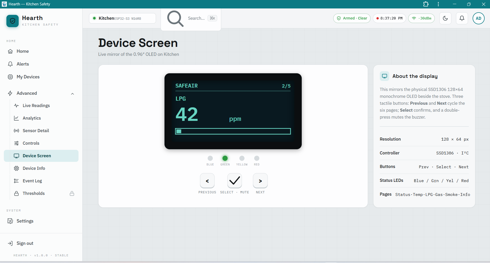
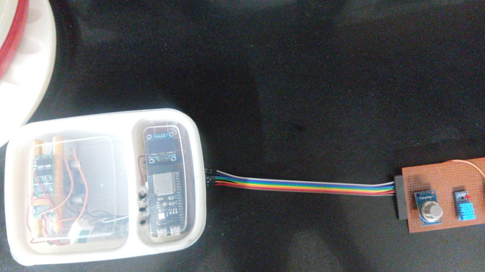

# 🔥 Hearth (SafeAir)

**An open-source, versioned reference project for IoT safety devices.** An ESP32 streams sensor telemetry to Firebase Realtime Database, and a web app or Progressive Web App displays it live and sends commands **back** to the physical device.

SafeAir is the stove-safety build of the Hearth framework. It watches the air in a kitchen for LPG, methane, smoke and heat, sounds the alarm before things get dangerous, can trigger a suppression pump, and lets you act from your phone.

> Gas leaks and kitchen fires happen in seconds. SafeAir is designed to notice first, warn loudly, and let you act from anywhere.

---
## 📸 Project Showcase

| Live Dashboard (PWA) | Physical Prototype (ESP32 + Sensors) |
|:---:|:---:|
|  |  |
| *Real-time gas/smoke monitoring with alarm controls.* | *Veroboard assembly with OLED display & relay module.* |
## Quick Start — How to Use This Repository

**If you want to run SafeAir:**
1. Read this README top-to-bottom for context
2. Flash `firmware_final/main/` to your ESP32 (see its `SETUP.md` or inline comments for wiring/config)
3. Host the web app from `v4_modular_bridge/` (or `v3_pwa_monolith/` until V4 is added)
4. Open the app in a browser or install it as a PWA on your phone

**If you want to learn how it was built:**
1. Start with `v1_send_only/` — simplest, shows the data pipeline + backend skeleton
2. Move to `v2_back_functionality/` — adds two-way control
3. Then `v3_pwa_monolith/` — adds installable PWA (but messy single-file)
4. Finally `firmware_final/main/` — the production-ready ESP32 code

**If you want to contribute or extend:**
1. Read `docs/VERSIONS.md` for the full narrative of each stage's tradeoffs
2. Read `docs/SETUP.md` for dev environment setup
3. Check `CONTRIBUTORS.md` for team roles

For the complete story of what each version gave up and why, read [docs/VERSIONS.md](docs/VERSIONS.md).
## 📖 Terminology (read this first)
 The Complete SafeAir System

SafeAir has two parts that work together:

| Part | Folder | Runs on | Purpose |
|---|---|---|---|
| **Firmware** | `firmware_final/main/` | ESP32 microcontroller | Reads sensors, controls pump/alarm, publishes telemetry, listens for commands |
| **Web App (PWA)** | `v4_modular_bridge/` (or `v3_pwa_monolith/` for now) | Browser / Phone | Displays live data, sends user commands back to the device |

Both parts talk to the same Firebase Realtime Database. The firmware **writes** telemetry and **listens** for commands. The web app **listens** for telemetry and **writes** commands. This is the "Back-Functionality" described throughout the docs.

**You need both to have a working SafeAir system.**
- **Backend**: the server-side infrastructure (Firebase rules, database layout, and Cloud Functions).
- **Back-Functionality**: the app's ability to register user actions (buttons, choices) online and have them executed on the physical ESP32 device, through bidirectional RTDB sync.

---

## ✨ Features

- **Real-time multi-sensor monitoring** of LPG (MQ-2), methane (MQ-4), smoke and temperature/humidity (DHT11), sampled once per second.
- **Three-level alarm logic**: `SAFE → WARNING → DANGER`, with thresholds stored in non-volatile memory.
- **Automatic suppression**: a pump/valve output that can be armed and fired automatically or on command.
- **Local controls**: three tactile buttons and an OLED screen with multiple pages (live readings, alarm state, device info, logs).
- **Zero-touch Wi-Fi setup**: no hard-coded network credentials. On first boot the device creates its own hotspot and serves a setup page.
- **Live cloud sync** through Firebase Realtime Database: telemetry, heartbeats, command queue, acknowledgements and logs.
- **Back-Functionality**: mute, test, arm/disarm, and pump control from the app, each confirmed by the device with an acknowledgement.
- **Control from anywhere, no websockets**: the phone and the device both talk to Firebase over HTTPS, so the app works on mobile data while the device sits on your home Wi-Fi. No port forwarding, no static IP.
- **A reusable smart-device kit**: `WiFiManager` and `FirebaseManager` can make *any* device smart. Swap in your own sensors and actuators, and you get the same setup, cloud sync and two-way control. See [Turning Anything Into a Smart Device](docs/BUILD_A_SMART_DEVICE.md).
- **Serverless backend** (Firebase Cloud Functions) for telemetry processing, notifications, command handling and history archiving.
- **Built to survive bad networks**: the alarm and suppression logic run locally on the device and never wait for the cloud.

---

## 🧭 Versions at a glance

Each folder is a self-contained stage. They are **not** merges of each other. Pick the stage that matches your needs.

| Stage | Folder | What it adds | Tradeoff / limitation |
|---|---|---|---|
| V1 | `v1_send_only/` | Device → cloud telemetry pipeline and backend skeleton | **Send-only:** the app cannot command the device, but there is **zero listener latency** |
| V2 | `v2_back_functionality/` | Bidirectional RTDB sync: web app actions run on the ESP32 | No PWA or offline support; two-way listeners add sync latency and bandwidth |
| V3 | `v3_pwa_monolith/` | Installable PWA with Back-Functionality | Monolithic: the bridge is merged into `safeair-app.html`, a maintainability cost |
| V4 | `v4_modular_bridge/` | `pwa_firebase_bridge.js` separated from the app HTML | Cleanest web stack; assemble the manifest and service worker from V3 if the folder is missing them |
| Firmware | `firmware_final/main/` | Final ESP32 firmware with all managers | Speaks the bidirectional schema from V2; needs your own config values |

**Full details for every stage, including what each one gave up and why it mattered, are in [docs/VERSIONS.md](docs/VERSIONS.md).**

### The core tradeoff

- **No listeners (V1)**: lowest latency and simplest, but read-only.
- **Listeners (V2–V4)**: remote control, at the cost of sync latency.
- **PWA (V3–V4)**: an installable, offline-capable shell, at the cost of extra assets.

### Recommended production stack

1. Flash `firmware_final/main/` after filling in your own config values.
2. Host the app from `v4_modular_bridge/` (or `v3_pwa_monolith/` for the ready-made PWA assets in one place).
3. Optionally grow the `v1_send_only/` backend skeleton into a secure middleman later.

**Rule of thumb:** device ↔ cloud always goes through Firebase RTDB. The app **listens** for telemetry and **writes** command nodes. The firmware **listens** for command nodes and **writes** telemetry.

---

## 🧠 How It Works

```
 ┌──────────────────────────── SafeAir Device (ESP32-S3) ────────────────────────────┐
 │  MQ-2 / MQ-4 / DHT11 ─▶ Sensors ─▶ Alarm logic ─▶ Buzzer · LEDs · Pump           │
 │                              │            │                                       │
 │                           OLED UI ◀── Buttons                                     │
 │                              │                                                    │
 │         Wi-Fi manager (AP setup + STA)  ─▶  Telemetry / Heartbeat / Ack           │
 └──────────────────────────────────┬────────────────────────────────▲────────────────┘
                                    │ JSON over HTTPS                 │ Commands
                                    ▼                                 │
                    ┌───────────────────────────────────┐             │
                    │  Firebase Realtime Database       │─────────────┘
                    │  devices/{id}/telemetry, commands │
                    │  heartbeat, ack, alerts, logs     │
                    └──────────────┬────────────────────┘
                                   │ triggers                ▲ live stream
                                   ▼                         │
                    ┌───────────────────────────────┐   ┌────┴─────────────────┐
                    │ Cloud Functions (backend)     │   │ SafeAir app (PWA)    │
                    │ • telemetry processing        │   │ live dashboard,      │
                    │ • notifications / alerts      │   │ controls, history    │
                    │ • command handling            │   └──────────────────────┘
                    │ • history archiving           │
                    └───────────────────────────────┘
```

The device is the source of truth for safety. The cloud is the window and the remote control. If Wi-Fi drops, the device keeps protecting the kitchen and syncs again when the connection returns.

---

## 🧩 Hardware

### Core components

| Component | Purpose | Interface |
|---|---|---|
| ESP32-S3-DevKitC-1 (N16R8) | Main controller, dual-core, Wi-Fi | — |
| MQ-2 gas sensor | LPG and smoke | Analog (GPIO 1) |
| MQ-4 gas sensor | Methane | Analog (GPIO 2) |
| DHT11 | Temperature and humidity | Digital (GPIO 4) |
| 0.96" OLED (SSD1306, 128×64) | Local status display | I²C (GPIO 8 / 9) |
| 3 × tactile buttons | Prev / Select / Next navigation | GPIO 5, 6, 7 |
| 4 × LEDs | Status (green, yellow, red, blue) | GPIO 10–13 |
| Buzzer | Audible alarm | GPIO 14 |
| Pump / valve driver (MOSFET) | Suppression output | GPIO 15 |

Pin assignments live in `Config.h`, so changing hardware means changing one file.

### Power and miscellaneous

These parts are required by our design. The exact models are a choice, so use your own if your hardware differs. Choose ratings that suit your load and the local rules for battery and mains work.

| Item | Why it's needed | Notes |
|---|---|---|
| 3S Li-ion battery pack (11.1 V nominal) | Backup power when mains fails | Use a pack with a protection board (BMS) |
| Buck converter(s), 12.6 V → 5 V and 5 V → 3.3 V | Power the pump, buzzer and relay from the battery, and the ESP32 from 5 V | Step-down (buck) type, sized for the peak current of the pump |
| Battery charger or power supply for the 3S pack | Keeps the battery charged from mains | Match the charge voltage and current to your pack |
| Fuse or polyfuse on the battery line | Protects wiring if a fault occurs | Rated for your pack's maximum current |
| Flyback diode across the pump or relay coil | Protects the MOSFET from voltage spikes | Fast-recovery or Schottky diode |
| Pull-up resistor (about 10 kΩ) on the DHT11 data line | Required for a reliable DHT11 reading | Often included on DHT breakout boards |
| Wiring, terminal blocks, enclosure | Safe, tidy build | Keep mains and low-voltage wiring apart |

> ⚠️ Battery and mains work can be dangerous. Follow your local electrical rules and get help if you're unsure. Never leave a lithium pack charging unattended.

---

## 💻 Software Architecture

The firmware is organised in three layers:

- **Hardware layer**: sensors, buzzer, pump, LEDs, buttons, display and NVS storage.
- **System layer**: Logger, WiFi manager, Firebase manager, JSON builder and Device manager.
- **Application layer**: alarm evaluation, command dispatch and the main tasks.

The managers are `WiFiManager`, `FirebaseManager`, `DeviceManager`, `PumpManager`, `SensorManager`, `DisplayManager`, `AlarmManager`, `ButtonManager`, `StorageManager` and `Logger`, with `JSONManager` building the payloads.

Five FreeRTOS tasks run in parallel:

| Task | Rate | Responsibility |
|---|---|---|
| `TaskSensors` | 1 Hz | Read and filter sensor values |
| `TaskAlarm` | 2 Hz | Evaluate alarm state, drive buzzer and pump |
| `TaskDisplay` | 5 Hz | Refresh the OLED |
| `TaskButtons` | 20 Hz | Debounce input, handle press / long press / double press |
| `TaskCloud` | ~3 s | Command dispatch and cloud sync |

### Wi-Fi provisioning

No credentials are compiled into the firmware. On first boot, or whenever no network is saved, SafeAir:

1. Starts a hotspot named `SafeAir-<device-id>`.
2. Serves a setup page at `192.168.4.1`.
3. Saves the network name and password to flash.
4. Reboots and joins your network.

A provisioning window times out after five minutes, and the device can also be reset to setup mode remotely from the app.

---

## ☁️ Cloud Data Model

```
devices/
└── kitchen-1/
    ├── telemetry/     ← sensor readings, alarm state, RSSI, uptime
    ├── heartbeat/     ← firmware version, IP, network, uptime
    ├── commands/      ← queue written by the app, read by the device
    ├── ack/           ← device confirmation for each command
    ├── alerts/        ← danger events for notifications
    └── logs/          ← device event log
```

The firmware pushes telemetry and heartbeats on a fixed schedule. The app subscribes to these paths in real time, so the dashboard updates without refreshing.

### How a command travels

```
 App (PWA)                    Firebase RTDB                   ESP32
 ─────────                    ─────────────                   ─────
 tap "Test alarm"  ──push──▶  devices/{id}/commands/{cmd}
                                      │
                                      └──stream──▶ FirebaseManager
                                                        │
                                                        ▼
                                               DeviceManager::onCommand()
                                                        │
                                                  does the action
                                                        │
 toast "Command     ◀──────── devices/{id}/ack ◀─────────┘
 confirmed"                                       (success or failure)
```

The device acts first and acknowledges second, so the app never says something happened when it didn't. Each command has an ID, and the acknowledgement carries the same ID. The step-by-step version is in [docs/BUILD_A_SMART_DEVICE.md](docs/BUILD_A_SMART_DEVICE.md).

---

## 📱 The App

The companion app is a web app and Progressive Web App, so it can be installed on a phone home screen (V3 and V4).

- **Dashboard**: live readings for each sensor, the device's online status, signal strength and uptime.
- **Alarm controls**: mute, unmute, test alarm, arm and disarm.
- **Suppression**: arm or disarm the pump, with a status indicator.
- **Confirmations**: every command shows a toast when the device acknowledges it, or reports a failure.
- **Danger alerts**: real-time notifications when a sensor crosses its danger threshold.

---

## 🚀 Getting Started

The full guide is in [docs/SETUP.md](docs/SETUP.md). It covers Arduino IDE on **Windows** and **Ubuntu**, board settings, the libraries, Firebase, flashing and troubleshooting. The short version:

### 1. Libraries (Arduino IDE → Manage Libraries)

| Library | Author | Required |
|---|---|---|
| Adafruit GFX Library (also installs Adafruit BusIO) | Adafruit | Yes |
| Adafruit SSD1306 | Adafruit | Yes |
| DHT sensor library (also installs Adafruit Unified Sensor) | Adafruit | Yes |
| Firebase-ESP-Client | mobizt | Yes |
| ArduinoJson | Benoit Blanchon | Likely (confirm in `JSONManager`) |

`Wire`, `WiFi`, `WebServer`, `Preferences` and `ESP.h` come with the ESP32 board package.

### 2. Firebase project

1. Create a project in the [Firebase Console](https://console.firebase.google.com) and enable **Realtime Database**.
2. Copy the database URL and the web API key.
3. Set the security rules (see [Security model](#-security-model)).
4. Deploy the Cloud Functions from `backend/functions/` (optional, requires the Blaze plan):
   ```bash
   cd backend/functions
   npm install
   firebase deploy --only functions
   ```

### 3. Firmware

1. Install the ESP32 board package (Espressif) and select **ESP32S3 Dev Module**.
2. Open `firmware_final/main/main.ino` in Arduino IDE. Arduino needs the sketch folder to match the main file name, so `main.ino` lives in a folder called `main`. Keep all the `.h` and `.cpp` files in that same folder.
3. Edit `Config.h` and set your Firebase host (without `https://`) and API key. The committed file uses placeholders such as `YOUR_FIREBASE_API_KEY`:
   ```cpp
   #define FB_HOST     "your-project-default-rtdb.firebaseio.com"
   #define FB_API_KEY  "YOUR_FIREBASE_API_KEY"
   ```
4. Set the board options listed in [docs/SETUP.md](docs/SETUP.md) (for example PSRAM: OPI, Flash: 16MB), then compile and upload.
5. Connect your phone to the `SafeAir-…` hotspot and enter your home Wi-Fi details.

### 4. App

1. Put your Firebase web config into the app's `FIREBASE_CONFIG` object, or into the git-ignored config file in the split layout.
2. Set `DEVICE_ID` to match the firmware (`kitchen-1` by default).
3. Host the app from `v4_modular_bridge/` (or `v3_pwa_monolith/`) on any static host: Firebase Hosting, GitHub Pages or Netlify.
4. Open the URL on your phone and add it to your home screen.

---

## 🔐 Security model

- **All API keys, URLs and credentials in this repository are placeholders** (such as `YOUR_FIREBASE_API_KEY`). Create your own Firebase project, paste your values locally, and keep the real values in git-ignored files (see `.gitignore`).
- **Protecting your data comes from Realtime Database security rules and Firebase App Check**, not from keeping the API key secret. A web API key is visible to anyone who loads the app.
- **The rules in this repository are open test rules** (`.read: true`, `.write: true`), published only so the project can be demonstrated. Anyone with the database URL can read and write data under them.
- **Write your own rules before storing real data.** Start from locked rules (for example, deny everything by default) and allow only the paths and users your device and app need. Add authentication and App Check before you rely on the system for anything that matters.
- **Rotate any key that has been shared publicly**, including keys pasted into chats or issue trackers.

> 🔐 **Security note:** API keys in a client app are not secret by themselves. Protect your data with Realtime Database security rules and App Check, and keep the device config out of public commits.

---

## 📚 Documentation

- [Version history](docs/VERSIONS.md): every stage in full detail, what each one gave up, and why it mattered.
- [Setup guide](docs/SETUP.md): Arduino IDE on Windows and Ubuntu, libraries, board settings, Firebase, flashing and troubleshooting.
- [Build a smart device](docs/BUILD_A_SMART_DEVICE.md): the core files, the command path, and a step-by-step example.
- [Contributors](CONTRIBUTORS.md): everyone who worked on the project and their roles.

---

## 🛣️ Roadmap

- [ ] Authenticated device access (Firebase Auth) and App Check instead of open rules
- [ ] Remote threshold editing from the app
- [ ] Push notifications through Firebase Cloud Messaging
- [ ] Sensor calibration routine with saved R0 values
- [ ] OTA firmware updates
- [ ] Historical charts and daily safety reports

---

## 🧪 Lessons Learned

Building SafeAir meant solving problems across hardware, firmware, cloud and frontend at the same time:

- **Captive-portal Wi-Fi setup on an ESP32** needs careful mode switching between access point and station, and a single owner for the network state machine.
- **Firebase streams and one-shot writes** should use separate connection objects, so the long-lived command listener never shares a connection with telemetry uploads.
- **Shared state across FreeRTOS tasks** needs one clear owner for each piece of state, or the tasks race each other.
- **Configuration errors are silent** on embedded hardware, so the logger and serial output matter as much as the code.
- **Latency and Back-Functionality trade off.** A send-only design (V1) is fast and simple. Listening for commands (V2 onward) makes the app useful and adds sync latency.

---

## 📁 Repository Layout

```
Hearth/
├── README.md                    ← you are here
├── CONTRIBUTORS.md              ← team and roles
├── .gitignore                   ← keeps real keys and config out of Git
├── v1_send_only/                ← V1: telemetry pipeline and backend skeleton
├── v2_back_functionality/       ← V2: bidirectional sync, web app (no PWA)
├── v3_pwa_monolith/             ← V3: installable PWA, bridge merged into the HTML
├── v4_modular_bridge/           ← V4: bridge separated into pwa_firebase_bridge.js
├── firmware_final/
│   └── main/                    ← final ESP32 firmware (open main.ino here)
│       ├── main.ino
│       ├── Config.h
│       └── ...                  ← manager .h and .cpp files
├── backend/                     ← Firebase rules, schema, Cloud Functions
└── docs/
    ├── SETUP.md                 ← full setup: Windows and Ubuntu
    ├── VERSIONS.md              ← full details for every stage
    └── BUILD_A_SMART_DEVICE.md  ← reuse the framework for other devices
```

> Use `firmware_final/main/` with `v4_modular_bridge/` for the recommended production stack. The other stage folders are kept for study and as alternatives. For the full story of each stage, read `docs/VERSIONS.md`.

---

## 🧩 Acknowledgments

Firebase, Espressif, Arduino Communities

---

## 📜 License

MIT License

Copyright (c) 2026 Muhammad Nouman, Faysal Ali Shah, Zimal Chohan, Alishba Shahwaiz, Fazila Iqbal

Permission is hereby granted, free of charge, to any person obtaining a copy
of this software and associated documentation files (the "Software"), to deal
in the Software without restriction, including without limitation the rights
to use, copy, modify, merge, publish, distribute, sublicense, and/or sell
copies of the Software, and to permit persons to whom the Software is
furnished to do so, subject to the following conditions:

The above copyright notice and this permission notice shall be included in all
copies or substantial portions of the Software.

THE SOFTWARE IS PROVIDED "AS IS", WITHOUT WARRANTY OF ANY KIND, EXPRESS OR
IMPLIED, INCLUDING BUT NOT LIMITED TO THE WARRANTIES OF MERCHANTABILITY,
FITNESS FOR A PARTICULAR PURPOSE AND NONINFRINGEMENT. IN NO EVENT SHALL THE
AUTHORS OR COPYRIGHT HOLDERS BE LIABLE FOR ANY CLAIM, DAMAGES OR OTHER
LIABILITY, WHETHER IN AN ACTION OF CONTRACT, TORT OR OTHERWISE, ARISING FROM,
OUT OF OR IN CONNECTION WITH THE SOFTWARE OR THE USE OR OTHER DEALINGS IN THE
SOFTWARE.
